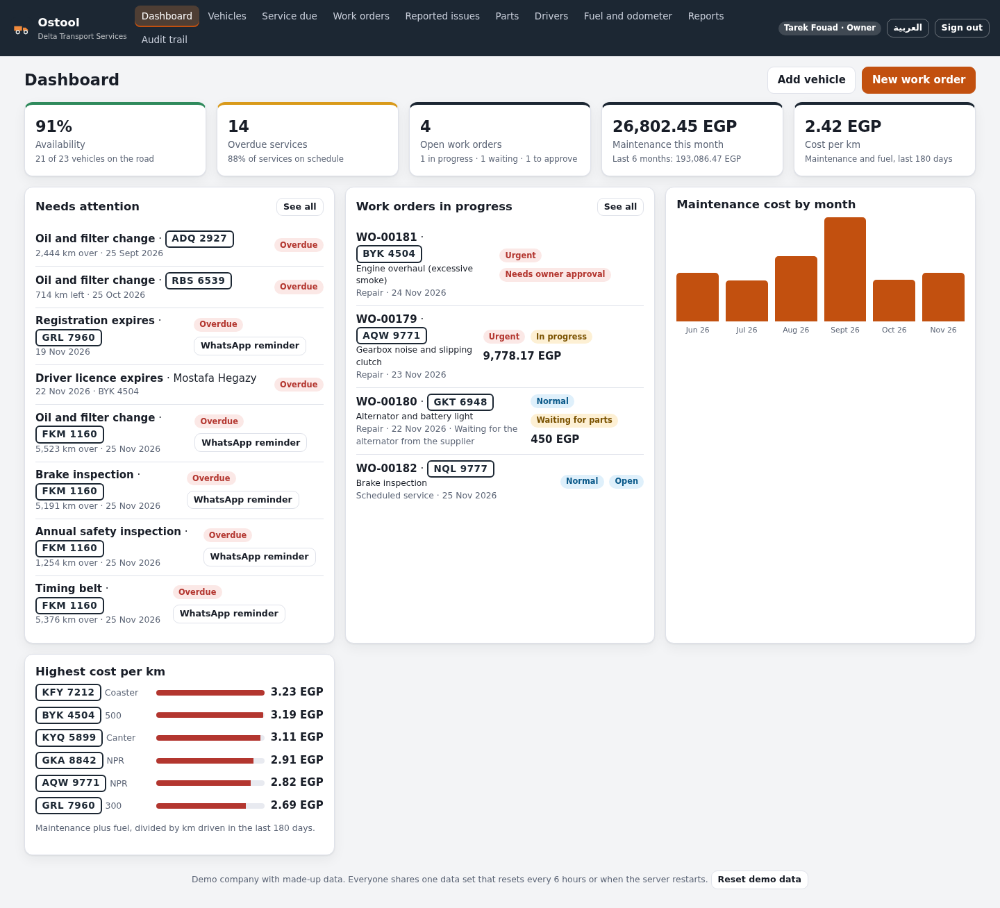
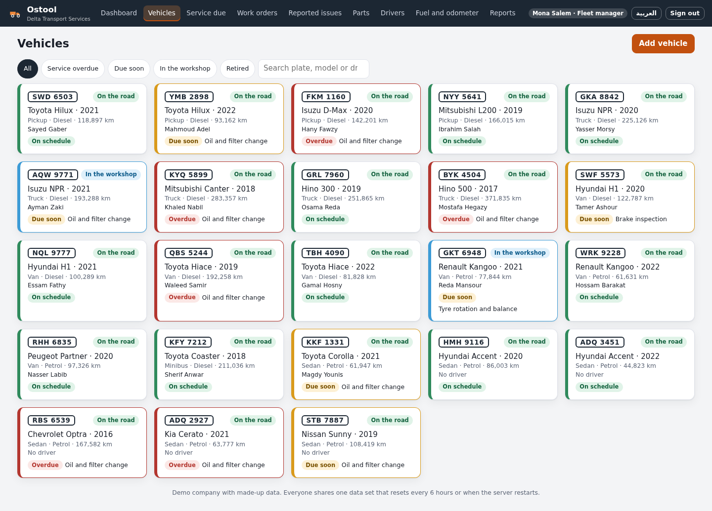
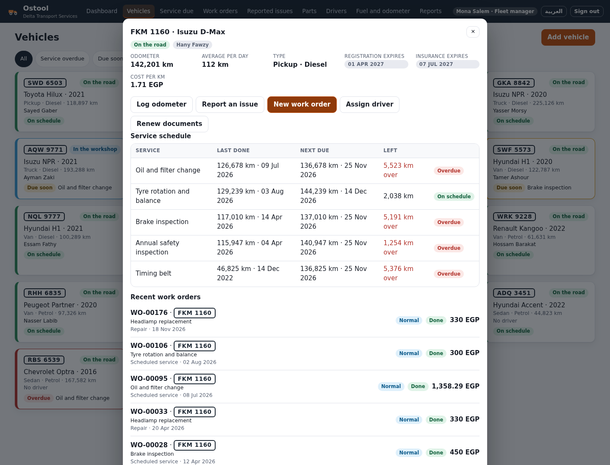
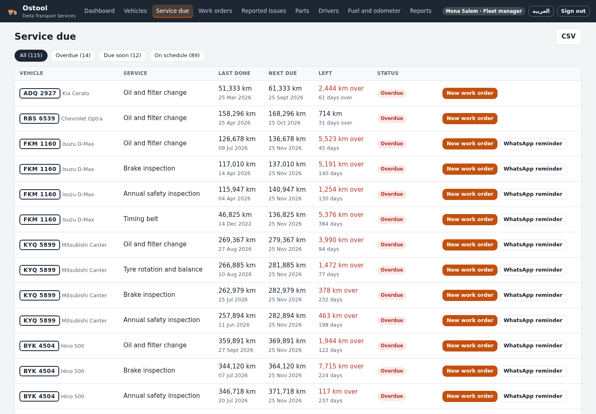
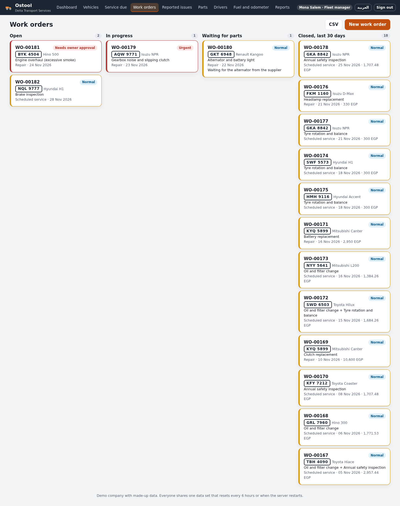
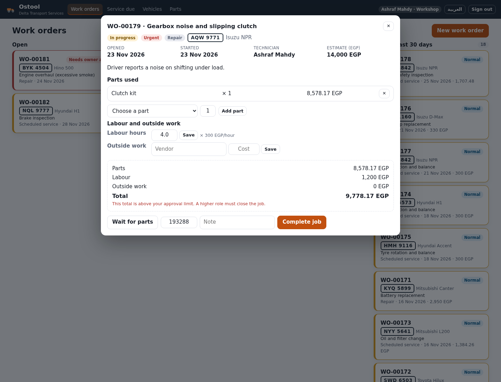
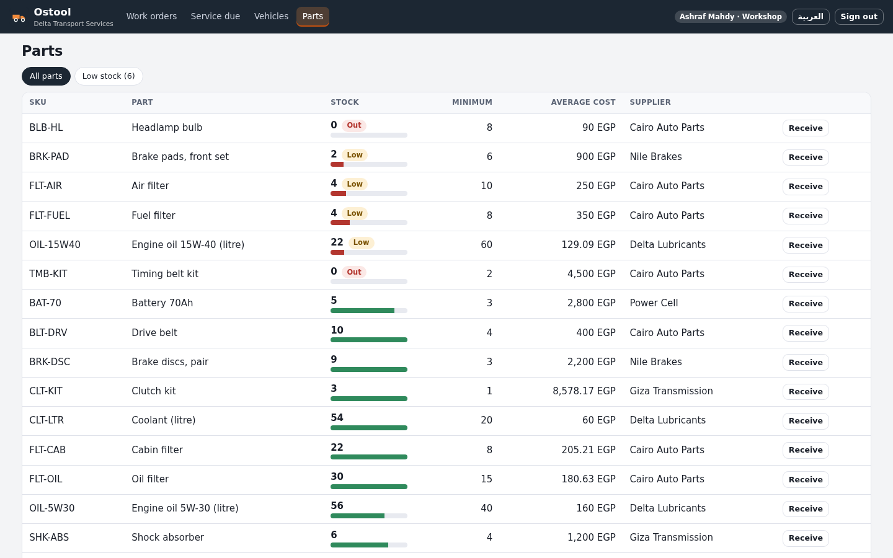
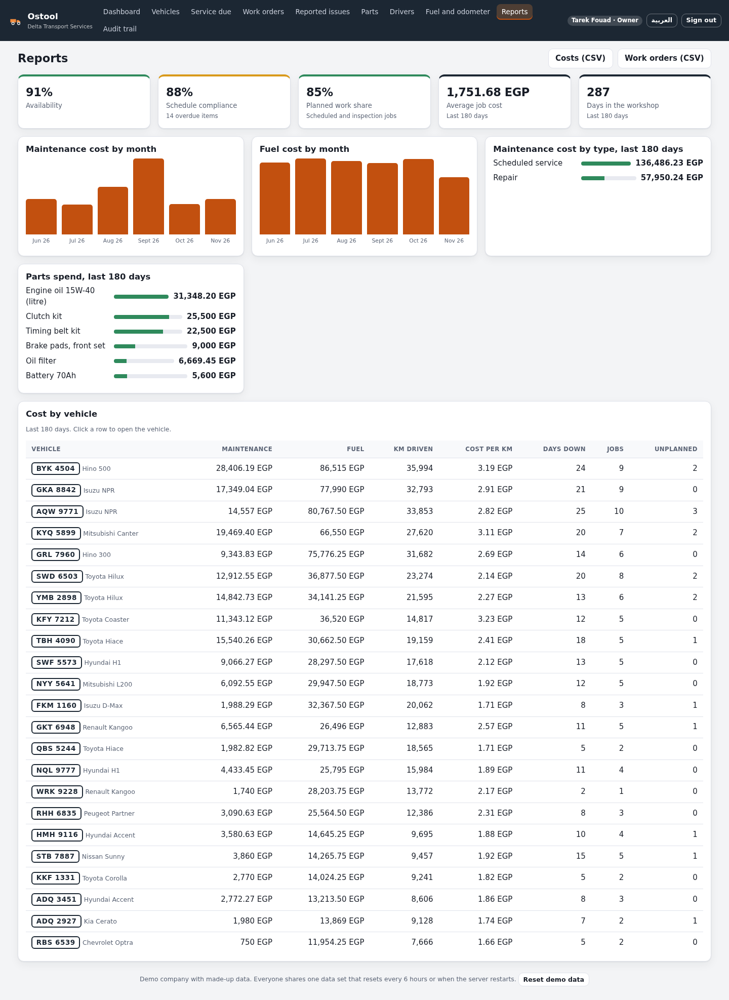
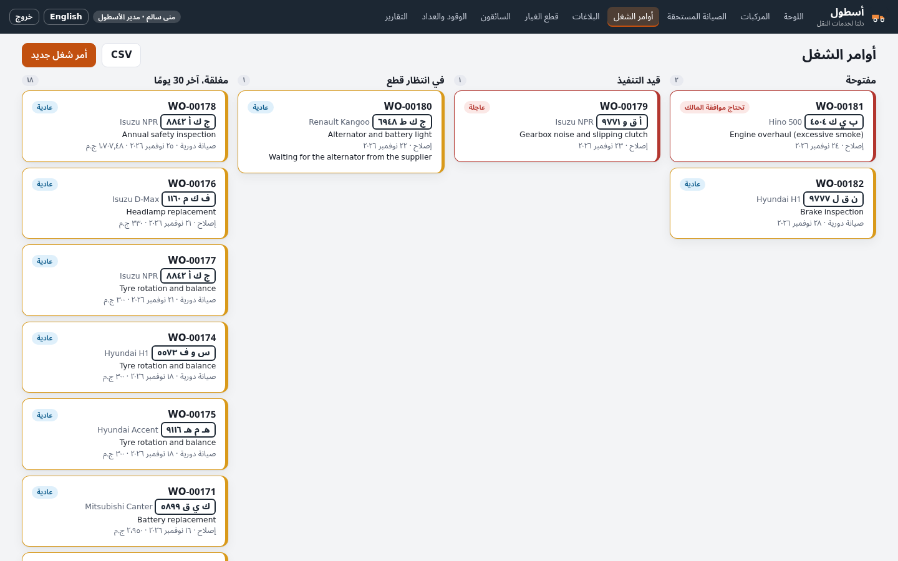

# Ostool (أسطول): fleet maintenance management

A bilingual (Arabic RTL / English) system for a small transport company's fleet: vehicles and plates, service schedules by kilometres and months, work orders with parts and labour, a parts store, drivers and licences, fuel and odometer logs, reminders, and cost reports.

**Live demo:** https://ostool-fleet.vercel.app
**Product direction, scope and delivery:** Nada Gamal.



## Try it

Open the demo and sign in with a PIN (the language button switches Arabic / English):

| Role | PIN |
| --- | --- |
| Owner (Tarek) | 1111 |
| Fleet manager (Mona) | 2222 |
| Workshop (Ashraf) | 3333 |
| Driver portal (Sayed Gaber) | 4444 |

The demo company, Delta Transport Services, runs 24 vehicles (one retired), 18 drivers, 18 stocked parts, 5 service plans and about 180 work orders over 6 months. The history is produced by running the real rules day by day, so it is dated relative to today. "Reset demo data" in the footer restores it.

## What it does

- **Service schedules.** Each vehicle follows 5 plans (oil and filter, tyres, brakes, annual inspection, timing belt). An item is due by kilometres or by months, whichever comes first, and shows as on schedule, soon or overdue. The next date is estimated from the vehicle's real daily distance.
- **Work orders.** Scheduled, repair, inspection and accident jobs. Flow: awaiting approval (when needed), open, in progress, waiting for parts, done or cancelled. Completing a scheduled job resets its schedule from the odometer reading entered at completion.
- **Parts and stock.** Parts used on a job leave stock at once and return if the line is removed or the order is cancelled. Receiving stock updates the average cost. Low-stock warnings. Counts need a reason.
- **Approval limits.** The workshop closes jobs up to EGP 5,000, the manager up to EGP 20,000, the owner any amount. Above the limit the job waits for a higher role. These are demo settings.
- **Issues.** Drivers report a problem on their own vehicle. The manager turns it into a work order or dismisses it with a reason.
- **Odometer and fuel.** Readings cannot go down, cannot jump past a daily maximum, and cannot be backdated far. Fuel entries check the price per litre.
- **Drivers.** Licence expiry, one vehicle per driver, and a driver with an expired licence cannot be assigned.
- **Reminders.** Registration, insurance, licence, service and low-stock reminders, with a WhatsApp link that has the message filled in.
- **Reports.** Availability, schedule compliance, planned versus unplanned work, cost per km, cost by month, by type and by vehicle, parts spend, days in the workshop. CSV exports with formulas neutralised.
- **Roles.** The owner sees everything including the audit trail. The manager runs the fleet, with no audit trail. The workshop sees orders, service due, vehicles and parts, with no fuel, reports or driver phones. A driver sees only their own vehicle, issues and history, with no costs.
- **Also.** Egyptian plates in Arabic or Latin letters, Arabic digits accepted in forms, an audit trail, safe handling of hostile text.

All business rules live in `public/logic.js` and are shared by the browser and the API.

## Screenshots

| | |
| --- | --- |
|  |  |
|  |  |
|  |  |
|  |  |

Arabic owner dashboard: `docs/dashboard-ar.png`. Driver portal on a phone: `docs/driver-ar-mobile.png`. Service due on a phone: `docs/service-ar-mobile.png`.

## Honest limits

This is a working demo, not a production system.

- The PINs are public and there is no real authentication, password reset or per-company accounts. The driver portal has one demo login.
- State is held in server memory only. It resets about every 6 hours and whenever the serverless instance restarts. Nothing is stored in a database, and if the host runs more than one instance they could briefly show different data.
- The odometer is typed in by hand. There is no GPS, telematics or OBD connection, so kilometre estimates depend on how often readings are logged.
- Reminders open a WhatsApp link on the staff member's device. Nothing is sent automatically, and there is no SMS or email.
- No real procurement, supplier orders, accounting, invoices or e-invoicing. Part prices and job costs are invented.
- Approval limits, the daily distance cap and the reminder windows are demo settings.
- Seed work-order titles are in English only. One company, one currency (EGP), Cairo time. Names, plates and phone numbers are invented.

## Tests

- `npm test`: 26 unit tests for the business rules (dates, plates, CSV, odometer, idempotency, fuel, work-order flow, schedule reset, stock, approval and limits, issues, driver rules, vehicles, parts, roles, privacy, reminders, seed).
- `node e2e/e2e.mjs <url>`: 136 browser and API checks against a running copy (needs Chrome at `/usr/bin/google-chrome`). They cover forged tokens, malformed and oversized bodies, every role's permissions, data each role must not see, the work-order flow, hostile text in forms, Arabic RTL, and phone layouts without overflow.
- `node e2e/shots.mjs <url>` regenerates the screenshots in `docs/`.

```
npm install
npm run dev            # http://localhost:3100
npm test
./run-local.sh node e2e/e2e.mjs http://localhost:3100
```

## Structure

```
public/logic.js   business rules, seed, reports (shared)
public/app.js     the single-page app
public/i18n.js    English and Arabic text
api/data.js       one JSON endpoint (Vercel serverless)
api/_auth.js      signed demo tokens
test/             unit tests
e2e/              browser and API checks, screenshot script
```
